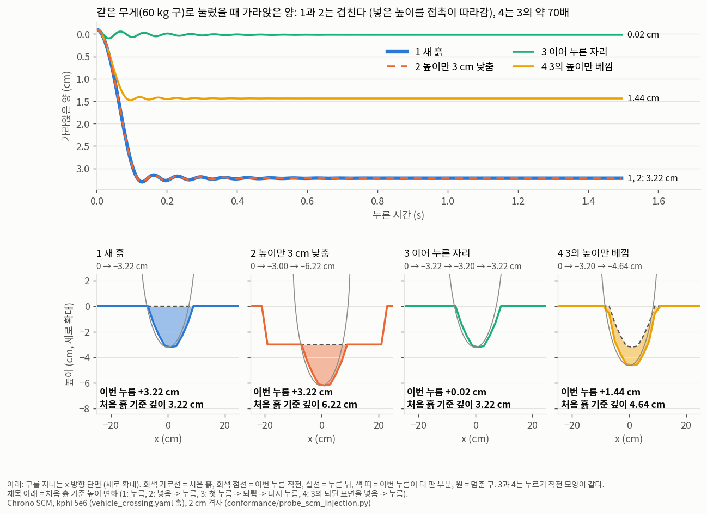
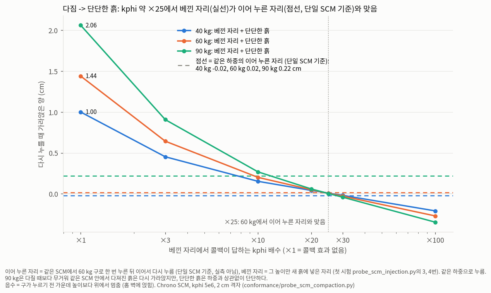
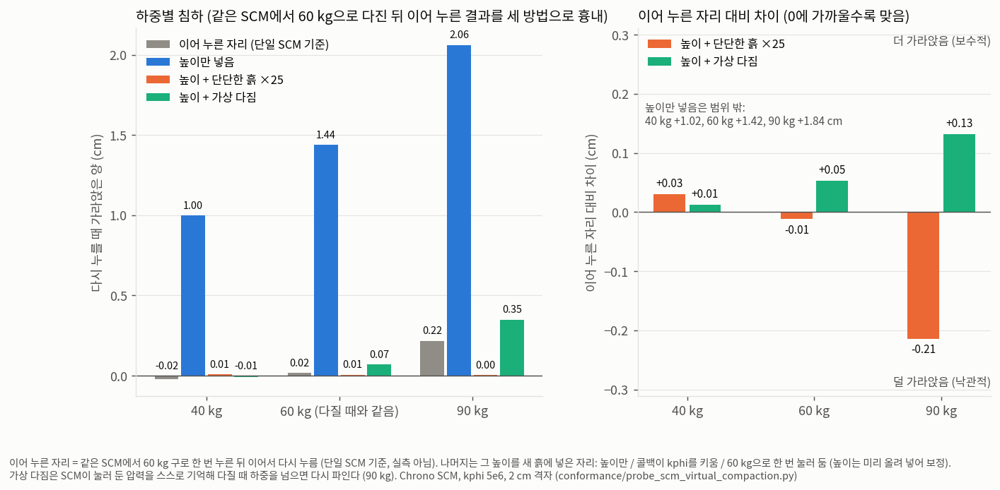
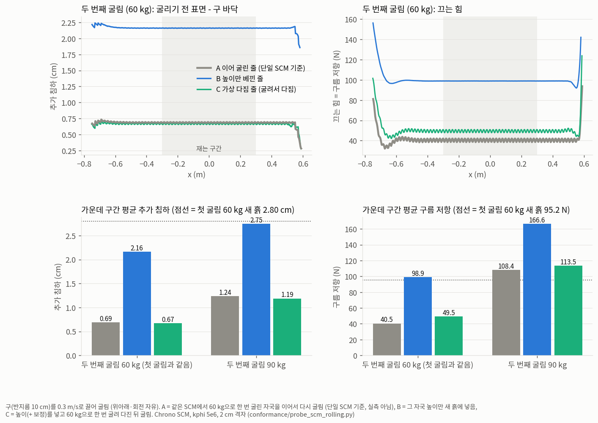

# 맵 서버 설계 (초안 v0.4, 2026-10-24)

v0.4: v0.3 검토 의견 반영 (흙 상태 전달, 시각 주인, 붙는 절차, `seq` 빈칸, 경계 규칙, NaN, 메모리, 일관성 감사, MOP 부록).
v0.4.1: SCM에 바깥 높이 넣기 시험 결과 (`conformance/probe_scm_injection.py`, 5.5, 9절).
v0.4.2: SCM에 바깥에서 흙 성질 넣기 (전체, 위치마다 콜백) 시험 결과 (4절, 5.5, 9절).
v0.4.3: "다짐 -> 단단한 흙" 콜백 시험 결과 (`conformance/probe_scm_compaction.py`, 5.5, 9절).
v0.4.4: "가상 다짐" 시험 결과와 세 방법 비교 (`conformance/probe_scm_virtual_compaction.py`, 5.5, 9절). 다짐 전달의 기본 후보를 가상 다짐으로.
v0.4.5: 비교 기준의 이름을 "실제로 다진 자리"에서 "이어 누른 자리 (단일 SCM 기준)"로 (실측값이 아님). 일관성과 타당성을 구분 (5.5).
v0.4.6: 구르는 구 시험 (`conformance/probe_scm_rolling.py`, 5.5, 9절): 굴릴 때도 높이만으로는 새 흙처럼 되고, 굴려서 하는 가상 다짐은 맞는다.
v0.4.7: 시험 기록 하나에서 분석 그래프와 Godot 재생 (`conformance/scm_record.py`, 5.5).

시뮬레이터(물리엔진) 여럿과 렌더러 여럿이 **같은 지형**을 쓰게 하는 별도 프로세스의 설계다. 아직 구현하지 않았다.
지금의 지형 공유(`docs/render_interface.md` 3절 지형 패치)는 이 설계의 1단계 결과와 같아야 한다.

```
                    ┌──────────────────── 맵 서버 ────────────────────┐
                    │ 타일 (tx, ty)                                   │
                    │   바탕: 미리 배포한 파일 (해시로 확인)           │
                    │   변경: 파임(min) + 편집(순서) + 소유 영역      │
                    └──────┬───────────────┬──────────────────┬──────┘
               읽기+쓰기    │      읽기+쓰기 │               읽기 │
        MuJoCo (로봇, 발 흙)     Chrono SCM (HMMWV)        렌더러 (Godot, RViz, MuJoCo 화면)
        로봇 주변 타일만          차량 주변 타일만           카메라 주변 타일만
```

## 1. 왜 필요한가

- 지금은 시뮬레이터 프로세스 하나가 지형의 원천이다 (`sim/terrain_service.py` TerrainMapService). 지형 전체를 메모리에 두고,
  MuJoCo에는 로봇 주변 창만 배포하고, 렌더러에는 시작할 때 전체 격자 1개와 이후 바뀐 사각형을 ROS2로 보낸다.
- 이 방식으로 안 되는 것:
  - **넓은 지형**: 1 km × 1 km를 5 cm로 하면 4억 칸(약 1.6 GB, float32). 한 프로세스가 들고 있거나 스트림으로 보낼 수 없다.
  - **여러 물리 프로세스**: 앞 차량이 만든 바퀴 자국을 다른 프로세스(다른 PC)의 뒤 차량이나 로봇이 밟아야 한다.
    지금은 같은 프로세스 안(`hmmwv_follow`: 로봇이 HMMWV 자국을 따라 걸음)에서만 된다.
  - **늦게 붙는 렌더러**: 지형 패치 토픽은 최근 500개만 다시 준다. 긴 시험에서는 앞부분을 놓칠 수 있다 (확인하지 않음).
  - **다른 PC 렌더러**: 메시와 지형 바탕을 같은 PC의 파일 경로로 가정한다 (매니페스트 `asset_root`).
- 미리 나눠 둔 데이터만으로는 안 된다: 시험 중 바뀌는 지형(바퀴 자국, 발자국, 이벤트 패치)은 미리 나눌 수 없고,
  양쪽 파일이 어긋나면 발이 땅에 묻히거나 뜬다 (LVC의 "지형 상관" 문제). 그래서 **안 바뀌는 바탕은 미리 배포 + 해시 확인,
  바뀌는 부분은 서버를 거쳐 동기화**한다.

## 2. 원칙

1. **지형의 원천은 맵 서버 하나**다. 물리엔진과 렌더러는 서버의 일부를 사본으로 들고 있는 클라이언트다.
2. **물리엔진만 쓴다.** 렌더러와 센서는 읽기만 한다. 화면 전용 표시(발자국 깊이)도 물리엔진이 쓰지만 물리 높이와 다른 층이다.
3. **실시간 루프는 서버를 기다리지 않는다.** 클라이언트는 자기 사본으로 계산하고, 변경은 비동기로 주고받는다.
   서버가 늦거나 끊겨도 물리 주기는 그대로이고, 늦은 만큼이 MOP(지형 동기화 지연)로 드러난다 (두뇌 연결과 같은 원칙).
4. **한 칸에는 그 칸을 오르내리게 하는 쓰는 쪽을 하나만 둔다.** 칸이 한 방향으로만 변하면 순서 없이 합칠 수 있고(파임은 min),
   오르내리면 순서가 결과를 정하므로 쓰는 쪽 하나가 순서대로 쓴다 (소유 영역, 운용자 편집). 5절.
5. **모든 변경에 시뮬레이션 시각과 쓴 쪽을 붙여 기록한다.** 기록을 같은 시각에 다시 적용하면 재현된다 (`scenario_replay.yaml`과 같은 생각).
6. **전송과 무관한 내용 규약**을 먼저 정한다 (렌더 스트림과 같다). 처음에는 ROS2로 싣는다.
7. 이 PC 밖으로 여는 것은 DIS 서버와 같은 규칙: 기본은 127.0.0.1, 밖은 인증 키 필수.
8. **시뮬레이션 시각은 시각 주인 하나가 정한다.** 원칙 3(기다리지 않음)과 5(시각을 붙여 기록)를 같이 쓰려면 모든 쓰는 쪽의
   `t`가 같은 시계에서 나와야 한다. 지금은 오케스트레이터(`sim.rt_link`, `sim.runner`)가 시각 주인이고 다른 프로세스는 그 시각을 받아
   쓴다 (두뇌 연결의 명령 시각과 같다). 실시간 다중 PC에서 시각을 맞추는 방법(시각 주인 방송, PTP 등)은 9절.

## 3. 좌표와 타일

| 항목 | 값 (초안) |
|---|---|
| 좌표 | `world`, REP-103 (렌더 스트림과 같다), m |
| 전역 격자 | 칸 (i, j)의 높이 점 = (i · res, j · res). res는 지도 전체에 하나 (지금 시나리오 5 cm, 발자국 2 cm) |
| 타일 | 한 변 N칸 (초안: N = 200, 5 cm면 10 m). 타일 (tx, ty)는 i ∈ [tx·N, (tx+1)·N), j ∈ [ty·N, (ty+1)·N) |
| 타일 키 | `"<층>/<tx>/<ty>"` |
| 높이 | 절대 높이 m, float32 little-endian, 행 우선 (행 = y). 렌더 스트림 지형 패치와 같은 인코딩 |

- 타일은 겹치지 않는다 (경계 점은 한 타일에만 속한다). 클라이언트가 이웃 타일을 붙여 연속 격자를 만든다.
- 지금의 TerrainMapService 격자(`xs = linspace(-half, half)`, 끝점 포함)는 반폭이 격자 간격의 정수배라(생성자에서 확인)
  점이 이미 전역 격자점 위에 있다. 1단계에서는 인덱스만 전역 (i, j)로 바꾸고, 결과가 지금과 비트 단위로 같은지 시험한다
  (`linspace`와 `i · res`의 부동소수 차이가 있는지 확인 필요).
- 타일 크기는 열린 문제다 (9절). 작으면 요청이 많고, 크면 로봇 하나가 쓰는 범위에 비해 많이 받는다.

## 4. 층

| 층 | 쓰는 쪽 | 읽는 쪽 | 해상도 | 합치는 규칙 | 지금 대응 |
|---|---|---|---|---|---|
| `height` 물리 높이 | 이벤트 패치, DIS 편집, Chrono SCM, (나중에) 발 흙 소성 변형 | 물리엔진, 센서, 렌더러 | 지도 res | 변경 종류별 (5절) | TerrainMapService `target` |
| `display_depth` 화면 전용 깊이 | 발 흙(`foot_soil`) | 렌더러만 | 지도 res | max (깊이를 양수로 적음 = 높이로는 min) | `/sim/terrain_overlay` |
| `soil_holes` 발 흙 구멍 | 발 흙 | 발 흙을 쓰는 물리엔진 | 1 cm | min (구멍 바닥 높이) | `foot_soil` 소성 지도 (지금은 프로세스 안에만) |
| `soil` 흙 종류 | 시나리오, DIS 콘솔 | 물리엔진, 렌더러 | 벡터 (직사각형 목록) | 순서 (버전) | `foot_soil.regions`, 매니페스트 `soil_regions` |
| 렌더러 장식 | (배포만) | 렌더러 | 자유 | 동기화하지 않음 | 없음. 풀, 바위, 고해상도 메시 등 |

- `height`가 기본이다. 1~3단계는 `height`와 `display_depth`만 다룬다.
- `soil_holes`를 서버에 올리면 다른 로봇도 앞 로봇의 발자국 구멍을 밟는다. 해상도가 지도와 다르므로 별도 타일 격자를 쓴다.
- `soil`은 래스터가 아니라 목록이다. 버전이 붙은 문서 하나로 둔다.
- **`soil`을 물리엔진에 넣는 길**: MuJoCo 발 흙은 지금도 지역 목록을 읽는다 (`foot_soil.regions`). Chrono SCM은 두 가지가 있다.
  - 흙 전체: `SetSoilParameters` (kphi, kc, n, 점착력, 마찰각, Janosi, 탄성, 감쇠). 실행 중에도 바꿀 수 있다 (지금 DIS 콘솔 `soil` 명령).
  - 위치마다: `RegisterSoilParametersCallback` (아래 "콜백"). SCM이 노드마다 "이 위치의 흙 성질은?"을 물으면 지역 목록을 보고 답한다.
    시험으로 확인했다 (2026-10-24): x > 0만 무른 흙(kphi 1e6)으로 답하게 하니 같은 구가 x < 0에서 3.20 cm, x > 0에서 6.29 cm 가라앉았다
    (콜백 없이는 둘 다 3.20 cm).

**콜백이란**: 내가 함수를 하나 만들어 SCM에 맡겨 두면, SCM이 계산하다가 필요할 때 그 함수를 **거꾸로 불러** 답을 받는 방식이다.
보통은 내가 SCM 함수를 부르지만(예: `SetSoilParameters`로 "흙은 이것"이라고 한 번 정함), 콜백은 SCM이 나를 부른다
("지금 (x, y) 노드를 계산하는데 여기 흙은 뭐지?"). 그래서 흙 성질을 위치마다, 시각마다 다르게 줄 수 있다.
- Python에서 쓰는 법: `pychrono.vehicle.SoilParametersCallback`을 상속해 `Set(loc, kphi, kc, n, coh, phi, js, ek, dr)`를 만든다.
  `loc` 외의 8개는 답을 적을 C++ 칸(`double&`)이라 Python 값으로 바로 바꿀 수 없고 `veh.doublep_assign(칸, 값)`으로 적는다
  (그냥 대입하면 아무 효과가 없다: 시험에서 확인).
- 비용: SCM이 접촉 중인 노드마다 매 스텝 부른다. 짧은 시험(구를 두 번 누름)에서 약 49만 번 불려 계산 시간이 약 2배(0.9 -> 1.9 s).
  넓은 지형이나 실시간에서는 C++로 같은 콜백을 만드는 편이 낫다.

## 5. 변경과 합치기

### 5.1 합치는 규칙

| 규칙 | 뜻 | 맞는 조건 | 쓰는 곳 |
|---|---|---|---|
| `min` | `새 값 = min(지금, 받은 값)` | 여러 쪽이 쓰고, 칸이 **내려가기만** 함 | 공유 영역의 파임 (`dig`), `soil_holes` |
| `max` | `새 값 = max(지금, 받은 값)` | 여러 쪽이 쓰고, 칸이 **올라가기만** 함 | `display_depth`(깊이). 높이에 쓰는 곳은 지금 없음 (선택지로만 둔다. 예: 아무도 밟지 않는 퇴적) |
| `ordered` | 서버가 매긴 버전 순서대로 적용 | 드물고 오르내림 | 운용자 편집 (`add`, `set`), `soil` |
| `owned` | 그 영역의 소유자 하나가 보낸 값을 그 쪽 일련번호 순서대로 | 잦고 오르내림 | 물리엔진 소유 영역 (`own`, 예: Chrono SCM 패치) |

- `min`, `max`는 순서 무관(min(a, b) = min(b, a)), 묶는 순서 무관, 두 번 해도 같음이라 도착 순서·중복·늦은 렌더러가 문제되지 않는다.
  대신 "가장 낮았던 / 높았던 값"만 남기고 변한 순서를 버린다. 그래서 칸이 **한 방향으로만** 변할 때만 맞다.
- 한 칸이 오르내리면 순서가 결과를 정한다. 층을 나눠도(파임 min + 둔덕 max) 일반적으로는 풀리지 않는다 (아래 예).
  그래서 오르내리는 칸에는 순서를 정하는 쪽을 하나 둔다: 드문 것은 서버 버전(`ordered`), 잦은 것은 소유자(`owned`).

| 순서 | 실제 | 파임 min + 둔덕 max로 나눴을 때 |
|---|---|---|
| 1. 앞 바퀴가 판다 (−5 cm) | −5 | D = −5 → −5 ✔ |
| 2. 옆 바퀴가 흙을 밀어 그 칸에 쌓는다 (+3 cm) | −2 | B = +3 → −2 ✔ |
| 3. 뒤 바퀴가 쌓인 흙을 밟아 −4 cm로 | −4 | B는 줄지 못하고 D는 −4 > −5라 무시 → −2 ✘ |

- 규칙 표는 지도 정보(`/map/info`)에 **변경 종류 -> 규칙**으로 싣는다 (예: `{"dig": "min", "add": "ordered", "set": "ordered",
  "own": "owned"}`). 클라이언트는 이 표를 읽어 따른다. 모르는 변경 종류나 규칙을 만나면 조용히 넘기지 않고 거부한다 (규약 버전).
  나중에 종류나 규칙을 더해도 메시지 형식과 클라이언트 구조는 그대로다.
- 물리 높이를 층에서 합치는 계산은 **맵 클라이언트 라이브러리 한 곳**에만 둔다. 물리엔진·센서·렌더러 코드는 합친 높이만 받는다.

### 5.2 물리 높이

```
공유 영역:  h = min( E , D )
  E (편집 지형) = 바탕 + 운용자 편집 (ordered)        드묾: 시나리오·DIS의 둔덕, 경사, 요철, 높이 정하기
  D (파임 지형) = 공유 파임의 min, 처음엔 +∞            잦음: 홈 이벤트, 소유 영역 밖의 발 흙
소유 영역:  h = O
  O = 소유자가 마지막으로 보낸 절대 높이 (owned)        잦음, 오르내림: Chrono SCM 바퀴 자국, (켜면) 흙 쌓임
```

- 지금 시나리오: 실행 중 편집이 없다(E = 바탕). Chrono는 지금 TerrainMapService에 바뀐 노드의 절대 높이를 덮어쓴다
  (`set_cells`) = 소유 영역과 같은 뜻이다. 그래서 1단계는 Chrono 패치 영역을 소유 영역(같은 프로세스, 소유자 = Chrono 연결)으로,
  나머지는 D(파임)로 해서 지금과 비트 단위로 같은지 확인한다. Chrono 값을 min으로 합치면 SCM이 높아지는 값을 낼 때 지금과 달라진다.

### 5.3 바탕
- 시험 전에 만든 파일 (`maps/<지도 이름>/<층>/<tx>_<ty>.npy` + `manifest.json`에 타일별 SHA-256).
  시나리오의 시작 패치(요철, 경사, 둔덕, 시작부터 있는 홈)로 만든 지형도 시작할 때 바탕으로 만든다. 렌더러 장식 파일도 같은 배포본에 둔다.

### 5.4 메시지 (공통)
`{"layer": "height", "op": 변경 종류, "tile": 키, "t": 시뮬레이션 시각, "writer": 쓴 쪽, "seq": 쓴 쪽의 일련번호,
"r0", "c0", "nrow", "ncol", "heights": base64 float32}`. 타일 안의 사각형 하나 (렌더 스트림 지형 패치와 같은 꼴).
바꾸지 않은 칸은 NaN으로 비운다. 서버는 받은 순서로 타일 버전을 1씩 올려 기록하고 관심 있는 클라이언트에 보낸다.
- **구현 주의 (NaN)**: `np.minimum(D, NaN)`은 NaN이 된다. 합칠 때는 `np.fmin` / `np.fmax`(NaN을 무시)를 쓰거나 마스크를 먼저 적용한다.
  합치는 계산은 클라이언트 라이브러리 한 곳(5.1)에 있으므로, 그 단위 시험에 NaN 칸, +∞ 칸, 중복 메시지, 순서가 바뀐 메시지를 넣는다.

### 5.5 파임 `dig` (공유 영역, min)
- `heights` = 바뀐 뒤의 **절대 높이**. 서버와 클라이언트: `D ← min(D, heights)`.
- 파임의 버전은 따라잡기("어디까지 받았나")에만 쓴다. 정확성에는 순서가 필요 없다.
- 변화량을 더하지 않으므로 두 쪽이 같은 칸을 각자 판 것이 두 배로 깊어지지 않는다 (더 깊은 쪽이 남는다).
  두 번 지나간 침하는 뒤쪽이 앞쪽 자국을 받은 지형 위에서 계산하므로 그 결과에 들어 있다 (6.3).
- 쓰는 쪽: 홈 이벤트(`patch_delta()`를 그 사각형의 지금 높이에 더한 결과), 소유 영역 밖의 발 흙(`soil_holes`).
- 높아지는 값은 서버가 그 칸에서 무시하고 MOP로 센다. 높이려면 편집으로 보낸다.
- **높이만으로는 흙 상태가 전달되지 않는다.** SCM 노드는 높이 말고도 소성 침하(`sinkage_plastic`), 다짐 이력(`sigma_yield`),
  전단(`kshear`, `tau`) 상태를 들고 있다 (설치된 Chrono의 `SCMTerrain.GetNodeInfo`로 확인). 바깥에서 넣는 `SetModifiedNodes`는
  노드 높이 목록만 받는다. 그래서 공유 영역을 거친 자국은 받는 엔진에게 "다진 이력 없는, 높이만 낮은 새 흙"이 되고,
  뒤 차량이 이미 다져진 자국 위에서 다시 크게 가라앉을 수 있다.
  **시험** (`python conformance/probe_scm_injection.py`, 약 4초. 어느 환경이든 chrono 환경으로 다시 실행): 구(반지름 10 cm, 60 kg)를 무게로 누른다.
  흙은 `vehicle_crossing.yaml`과 같다 (kphi 5e6, 2 cm 격자).

  | 자리 | 가라앉은 양 | 뜻 |
  |---|---|---|
  | 1. 새 흙 | 3.22 cm | 기준 |
  | 2. `SetModifiedNodes`로 3 cm 낮춘 판 | 3.22 cm (바닥 −6.22 cm) | 넣은 높이를 접촉이 정확히 따라간다 |
  | 3. 한 번 누른 자리를 이어서 다시 누름 (같은 SCM) | 0.02 cm | 다짐 이력(`sigma_yield`)이 남아 거의 안 가라앉는다 |
  | 4. 3의 높이만 새 흙에 베껴 넣고 누름 | 1.44 cm | 넣은 노드는 새 흙이 된다 (넣은 직후 `sinkage`, `sinkage_plastic`, `sigma_yield` 모두 0). 3의 약 70배 |

  

  **시험 기록**: 이 절의 시험(`conformance/probe_scm_*.py`)은 결과를 기록 하나(`--record build/scm_<시험>.npz`, 규약
  `conformance/scm_record.py`)에 담는다. 분석 그래프는 그 기록에서 그리고(`conformance/plot_scm_probe.py`, 시뮬레이션 없이),
  누르기·굴리기 기록은 같은 기록을 Godot로 재생한다(`conformance/replay_scm_probe.py`). 그래서 그래프와 화면이 같은 실행에서 나온다.
  `--plot PNG`은 기록을 저장한 뒤 그 기록으로 그린다.

  **비교 기준은 실측값이 아니다**: 이 절의 시험들에서 기준인 "이어 누른 자리"는 같은 SCM 안의 같은 자리를 구로 한 번 누르고
  (1.5초), 떼고 (0.2초), 이어서 다시 누른 결과다. 두 누름 사이에 SCM을 새로 만들거나 흙 상태를 옮기지 않으므로 첫 누름의 다짐 상태
  (`sigma_yield`, 소성 침하)를 그대로 기억한 채 계산된다. 곧 "SCM 하나가 그 자리를 처음부터 계속 계산했다면 나왔을 값"이다.
  이 시험들의 질문은 "자국을 다른 SCM(또는 엔진)으로 넘겨도 단일 SCM과 같은가"이고, 오차는 그 기준에 대한 **일관성** 오차다.
  - **일관성** (엔진 사이): 넘긴 쪽과 단일 SCM이 같은가. 이 절의 시험이 재는 것.
  - **타당성** (모델과 실제): 단일 SCM이 실제 흙과 같은가. 하지 않았다. 판 재하 시험(같은 자리를 여러 번 눌러 하중-침하를 잼)이나
    같은 바퀴 자국을 여러 번 지나는 시험의 실측과, 그 흙에 맞춘 매개변수가 필요하다. 지금 흙(kphi 5e6 등)은 "단단한 흙"을 대략
    흉내 낸 값이라 특정 흙을 측정해 맞춘 것이 아니다.

  3D로 보기: `python conformance/replay_scm_probe.py` (시험 기록을 중립 렌더 스트림으로 재생해 Godot로. 자리 번호 1~4는 위 그림과 같다).

  넣은 높이가 그 노드의 새 출발점이 되고, 거기서 처음 누르는 흙처럼 계산한다. 4가 3.22 cm보다 덜 가라앉은 것은 구 모양 홈이라
  처음부터 접촉 면적이 넓어서로 보인다. 한계: 구를 무게로만 눌렀다 (구르는 바퀴의 전단 `kshear`, `tau`는 보지 않음), 흙 한 종류.
  정한 것:
  - **차량이 지나는 길은 소유 영역으로 둔다** (같은 SCM 안에서 여러 차량·로봇 발). 공유 영역의 파임은 작은 변형
    (홈 이벤트, 소유 영역 밖의 발 흙)만 다룬다.
  - 공유 영역을 거친 경우의 침하 차이를 같은 경로를 단일 SCM으로 돌린 결과와 비교해 MOP로 잰다 (부록).
  - 다짐 층(`compaction`, 다짐은 늘기만 하므로 max)은 받는 엔진이 그 값을 흙 모델에 넣을 길이 있어야 한다. 노드의 다짐 상태
    (`sigma_yield`, 소성 침하)를 바깥에서 넣는 길은 찾지 못했다 (9절). 우회 후보 둘 (둘 다 시험하지 않음):
    - "가상 다짐": 높이를 넣은 뒤 같은 하중으로 한 번 눌러 다짐 상태를 다시 만든다. **시험함 (아래): 기본 후보.**
    - "다짐 -> 단단한 흙": 위치마다 흙 성질 콜백(4절)이 다짐 층을 보고, 다져진 자리에서는 더 단단한 흙 성질(높은 kphi)을 답한다.
      **시험함 (아래)**: 다질 때 하중 이하에서는 잘 맞고, 더 무거운 하중에서는 덜 가라앉는다.

  **"다짐 -> 단단한 흙" 시험** (`python conformance/probe_scm_compaction.py --plot docs/img/scm_compaction.png`, 약 1분 10초):
  두 자리를 같은 하중으로 누른다 (위 시험의 3, 4번 자리와 같다). **이어 누른 자리**: 60 kg으로 한 번 다진 뒤 다시 누름.
  **베낀 자리**: 이어 누른 자리의 높이만 새 흙에 넣고 누름. 베낀 자리에서만 콜백이 kphi × 배수를 답한다
  (한 번 실행마다 새 SCM, 다시 누르는 하중 40 / 60 / 90 kg).

  

  | 다시 누르는 하중 | 이어 누른 자리 (단일 SCM 기준) | 베낀 자리 (×1, 콜백 효과 없음) | 베낀 자리 + 단단한 흙 ×25 |
  |---|---|---|---|
  | 40 kg (다질 때보다 가벼움) | −0.02 cm | 1.00 cm | 0.01 cm |
  | 60 kg (다질 때와 같음) | 0.02 cm | 1.44 cm | 0.01 cm |
  | 90 kg (다질 때의 1.5배) | 0.22 cm | 2.06 cm | 0.00 cm |

  - 60 kg에서 배수를 바꾸면 베낀 자리의 침하가 ×1 1.44, ×3 0.64, ×10 0.20, ×20 0.05, **×25 0.01**, ×30 −0.03 cm.
    약 ×25에서 이어 누른 자리와 맞는다 (오차 1.42 -> 0.01 cm). 처음 흙 기준 깊이도 3.21 cm로 이어 누른 자리(3.22 cm)와 같다.
  - **다질 때 하중 이하에서는 맞는다** (40, 60 kg). **더 무거운 하중에서는 덜 가라앉는다** (90 kg: 이어 누른 자리 0.22 cm, 단단한 흙 0.00 cm).
    같은 SCM 안에서 다져진 흙은 예전에 견딘 압력(`sigma_yield`)을 넘으면 다시 가라앉지만, 단단한 흙은 하중과 상관없이 단단하다.
    그래도 콜백 없을 때의 오차(2.06 vs 0.22 cm)보다 훨씬 작다.
  - 음수 = 구가 누르기 전 가운데 높이보다 위에서 멈춤: 흙이 너무 단단해 구가 홈 바닥까지 못 내려가고 홈 벽에 얹힘 (×30 이상).
  - 뜻: 앞 차량과 같거나 가벼운 차량·로봇이 따라가는 경우는 이 방법으로 다짐을 꽤 잘 흉내 낸다. 앞 차량보다 무거운 쪽이 따라가면
    침하를 덜 잡으므로 MOP에 표시한다 (부록 "단일 SCM 대비 침하 차이").
  - 한계: 배수 25는 이 흙(kphi 5e6), 이 구(반지름 10 cm), 이 하중(60 kg)에서 찾은 값이다. 흙·바퀴·하중이 다르면 달라질 것으로 본다.
    맵 서버의 다짐 층에 무엇을 실어 배수를 정할지(예: 앞 쪽 SCM의 `sigma_yield`나 다진 하중)는 정하지 않았다 (9절).
    구를 누르기만 했다 (구르는 바퀴는 보지 않음). 비용: 한 번 실행에 콜백 약 74만 번, 콜백 없을 때보다 약 4배 느림.
  - 왜 하중마다 맞는 배수가 다른가: 같은 SCM 안에서 다져진 흙에는 **문턱**이 있다. 예전에 견딘 압력(`sigma_yield`)보다 약하게 누르면 탄성으로만
    조금 들어가고, 넘으면 원래 흙 성질대로 다시 영구히 파인다. "단단한 흙"은 하중-침하 곡선 전체를 단단하게 바꿀 뿐 문턱이 없다.
    콜백은 위치마다 흙 **성질**만 답할 수 있고 "이 노드는 예전에 이만큼 눌렸다"는 **상태**는 담지 못한다.

  **"가상 다짐" 시험** (`python conformance/probe_scm_virtual_compaction.py --plot docs/img/scm_virtual_compaction.png`, 약 35초):
  처음 상태만 넘기고 그 뒤는 받는 SCM이 스스로 기억하게 한다. 이어 누른 자리의 높이를 새 흙에 넣고 **다질 때와 같은 하중(60 kg)으로
  한 번 눌러 둔다**. 흙 성질은 원래대로 (콜백 없음). 그러면 받는 SCM 안에 자기 `sigma_yield`가 생기고, 이후 하중은 SCM이 그대로 계산한다.
  - 높이 보정: 눌러 두는 동안 흙이 1.42 cm 더 내려간다. 그만큼 미리 올려 넣는다. 이 시험은 같은 과정을 되풀이해 맞췄다
    (노드마다, 차이 최대 1회 1.42 -> 2회 0.59 -> 3회 0.45 -> 4회 0.06 cm). 보정 없이 넣으면 처음 흙 기준 깊이가 4.69 cm (이어 누른 자리 3.22 cm).

  

  | 다시 누르는 하중 | 이어 누른 자리 (단일 SCM 기준) | 높이만 | 높이 + 단단한 흙 ×25 | 높이 + 가상 다짐 (보정 4회) |
  |---|---|---|---|---|
  | 40 kg (가벼움) | −0.02 cm | 1.00 cm | 0.01 cm | −0.01 cm |
  | 60 kg (다질 때와 같음) | 0.02 cm | 1.44 cm | 0.01 cm | 0.07 cm |
  | 90 kg (1.5배) | 0.22 cm | 2.06 cm | 0.00 cm | 0.35 cm |

  - **가상 다짐은 문턱을 재현한다**: 다질 때 하중 이하에서는 거의 안 들어가고, 넘으면 다시 파인다 (90 kg 0.35 cm). 배수를 맞출 필요가 없다.
  - 오차 방향: 가상 다짐은 조금 **더** 가라앉는다 (60 kg +0.05, 90 kg +0.13 cm, 보수적). 단단한 흙은 무거운 하중에서 **덜** 가라앉는다
    (90 kg −0.21 cm, 낙관적). 시험평가에는 보수적인 쪽이 낫다. 더 가라앉는 이유는 이미 파인 홈을 눌러 둬 처음부터 접촉 면적이 넓고,
    그만큼 압력이 낮아 기억된 `sigma_yield`가 단일 SCM의 다짐보다 작게 남았기 때문으로 본다 (확인하지 않음).
  - **정한 것: 다짐 전달의 기본 후보는 가상 다짐**. 맵 서버의 다짐 층에는 높이와 함께 그 자리가 견딘 압력(앞쪽 SCM의 `sigma_yield`) 또는
    지나간 하중을 싣고, 받는 SCM이 넘겨받을 때 그 압력으로 한 번 눌러 둔다 (소유 시작, 이양, 공유 영역에서 받은 자국).
  - 남은 것: (1) 높이 보정을 되풀이 없이 흙 식(Bekker)으로 계산하기, (2) 누르개의 모양과 압력: 구 자리를 같은 구로 누른 쉬운 경우만 봤다.
    바퀴 자국처럼 긴 모양은 누르개를 자국 따라 움직이거나 노드마다 넘겨받은 압력으로 누르는 방법이 필요하다, (3) 구르는 바퀴,
    (4) 넘겨받을 때 한 번 누르는 비용 (이 시험의 누름 한 번 = 시뮬레이션 1.7초 분량, 이 PC에서 약 0.5초. 구 하나 자리 기준).

  **구르는 구 시험** (`python conformance/probe_scm_rolling.py --plot docs/img/scm_rolling.png`, 약 30초): 누르기 대신 굴린다. 같은 흙·구(반지름 10 cm)를 흙에 올려
  1초 가라앉힌 뒤 수평으로 0.3 m/s로 끈다 (1.4 m). 끄는 힘은 위치·속도 추종이고 위아래와 회전은 자유라 바닥 마찰로 저절로 구른다.
  흙을 미는 전단(`kshear`, `tau`)과 구름 저항이 들어간다. 한 SCM에 세 줄 (0.5 m 간격):
  - **A 이어 굴린 줄 (단일 SCM 기준)**: 60 kg으로 한 번 굴려 자국을 만들고 같은 자국을 하중 M으로 다시 굴린다.
  - **B 높이만 베낀 줄**: A의 첫 자국 높이를 새 흙에 넣고 하중 M으로 굴린다.
  - **C 가상 다짐 줄**: A의 높이(+ 보정)를 넣고 60 kg으로 한 번 **굴려서** 다진 뒤 하중 M으로 굴린다.
    보정: 다지는 굴림 동안 1.98 cm 더 내려가 그만큼 올려 넣는다 (되풀이 3회로 줄 가운데 차이 1.98 -> 0.10 -> 0.04 cm).
  가운데 0.6 m 구간에서 두 번째 굴림의 추가 침하(굴리기 전 표면 - 구 바닥)와 평균 구름 저항(끄는 힘)을 잰다.
  첫 굴림(60 kg, 새 흙): 침하 2.80 cm, 저항 95.2 N.

  

  위 두 그림은 60 kg 두 번째 굴림을 x 방향으로 따라간 것이다 (추가 침하, 끄는 힘). 처음과 끝은 출발과 멈춤이라 빼고,
  가운데 회색 구간(0.6 m)의 평균을 아래 막대와 표에 쓴다. A(회색)와 C(초록)는 거의 겹치고 B(파랑)만 떨어져 있다.
  끄는 힘의 잔물결은 2 cm 격자 위를 구가 지나가며 생기는 것으로 본다 (확인하지 않음).
  3D로 보기: `python conformance/replay_scm_probe.py --probe rolling` (60 kg 실행 기록을 Godot로. 줄 A / B / C와 구의 회전 표시점).

  | 두 번째 굴림 하중 | 줄 | 추가 침하 | 구름 저항 |
  |---|---|---|---|
  | 60 kg | A 이어 굴린 줄 (단일 SCM 기준) | 0.69 cm | 40.5 N |
  | | B 높이만 베낀 줄 | 2.16 cm | 98.9 N |
  | | C 가상 다짐 줄 | 0.67 cm | 49.5 N |
  | 90 kg | A 이어 굴린 줄 (단일 SCM 기준) | 1.24 cm | 108.4 N |
  | | B 높이만 베낀 줄 | 2.75 cm | 166.6 N |
  | | C 가상 다짐 줄 | 1.19 cm | 113.5 N |

  - **굴릴 때도 높이만으로는 크게 틀린다**: B는 침하가 기준의 약 3배, 저항이 약 2.4배로 새 흙을 처음 굴리는 것(95.2 N)과 비슷하다.
    따라오는 차량·로봇의 구름 저항과 CoT가 단일 SCM보다 크게 나온다.
  - **굴려서 하는 가상 다짐은 맞는다**: 침하 차이 −0.02 / −0.05 cm, 저항 차이 +9.0 N (+22 %) / +5.1 N (+5 %) (60 / 90 kg).
    누르기와 달리 다질 때보다 무거운 90 kg에서도 맞았다. 저항이 조금 큰 것은 다지는 굴림이 단일 SCM과 똑같은 다짐·전단 상태를
    만들지 못했기 때문으로 본다 (보정한 높이 위를 굴려 기억된 압력 분포가 다를 수 있음, 확인하지 않음).
  - **굴리면 같은 하중으로 다시 지나가도 더 파인다**: 기준 A의 두 번째 굴림(60 kg)이 0.69 cm 더 들어갔다 (누르기 0.02 cm).
    구가 나아가며 앞쪽 흙에 예전보다 센 압력이 걸리거나 흙을 미는 전단이 더해지기 때문으로 본다 (확인하지 않음).
    그래서 다짐 효과는 누르기보다 굴리기에서 작게 나타난다.
  - 뜻: 바퀴 자국을 넘겨받는 쪽은 **자국을 따라 굴려서** 다져 두는 방법이 기본 후보다 (위 "남은 것" (2)의 긴 자국 문제에 대한 답).
    넘길 것은 높이와 그 자국을 만든 하중(또는 앞쪽 SCM의 `sigma_yield`), 다질 물체의 모양(구 또는 바퀴)과 경로.
  - 한계: 기준(A)은 단일 SCM 결과이며 실측이 아니다. 구 하나를 일정한 속도로 끈 경우만 봤다 (구동 토크와 미끄러짐 없음, 실제 바퀴
    모양 아님). 높이 보정은 되풀이로 맞췄다. 다지는 굴림 한 번은 시뮬레이션 5.7초 분량 (이 PC에서 약 2초, 1.4 m 줄 하나).

### 5.6 편집 `add`, `set` (운용자, ordered)
- 시나리오 이벤트와 DIS 콘솔만 보낸다 (드묾). 실행 중 `bump`, `ramp`, `rough`는 `add`, 높이를 정하는 명령은 `set`. `rut`은 파임이다.

| 편집 | E | 그 칸의 D (이미 있는 자국) |
|---|---|---|
| `add` (둔덕, 경사, 요철) | `E += δ` | D가 있는 칸만 `D += δ` (자국 모양 그대로 함께 옮김: 지금 `add_patch`와 같은 결과) |
| `set` (높이 정하기, 메우기, 복구) | `E = 값` | `D = +∞` (자국을 지움) |

- 모든 클라이언트가 서버 버전 순서대로 적용한다. 같은 반영 시점의 파임보다 먼저 적용한다.
- **늦게 온 이른 파임**: 편집 시각보다 이른 시각 `t`의 파임이 편집 뒤에 도착하면(네트워크 지연), 옛 지형 기준이라 그 칸에서 버린다.
  버린 수를 MOP로 센다 (편집 직전 수백 ms 안의 자국만 해당해 드물 것으로 본다).
  - 서버는 편집을 칸 배열이 아닌 **(칸 사각형, 시각) 목록**으로 기억한다 (편집은 드물다. 1 km 지도에서 칸마다 시각을 두면 메모리가 크다).
  - 두 시각(파임 `t`, 편집 `t`)은 같은 시계에서 나와야 한다 (원칙 8). 어긋나면 버려야 할 파임을 받거나 받아야 할 파임을 버린다.

### 5.7 소유 영역 `own` (물리엔진, owned)
- 지도 정보에 `[{"cells": [i0, j0, i1, j1], "owner": 쓴 쪽}]` (순서 있는 변경으로 바꾼다). 예: Chrono SCM 패치 영역.
  범위는 **칸 인덱스의 반열린 구간** `i ∈ [i0, i1)`, `j ∈ [j0, j1)` (3절 타일과 같은 규칙). 월드 좌표를 싣지 않아 부동소수 경계 문제가 없다.
- 소유자만 그 영역의 높이를 쓴다: 바뀐 칸의 절대 높이를 보내고, 모두 소유자의 `seq` 순서대로 그대로 쓴다 (오르내림 모두).
  소유자는 자기 안에서 시간 순서대로 계산하므로(SCM: 파임, 흙 쌓임, 다시 밟힘, 부피 보존) 순서가 저절로 맞다.
- 여러 차량이 같은 영역을 지나면 같은 소유자(같은 SCM) 안에서 돌린다 (지금 `hmmwv_follow`가 그렇다).
  로봇 발도 소유자 안에 대리로 넣는다 (지금 `footprints`: 발 대리 구가 SCM 안에서 자국을 만든다).
- 소유 시작: `O ← 지금 h`로 시작하고 소유자가 그 높이를 받는다. 소유 끝: 그 칸의 `E ← O`, `D ← +∞` (공유 영역으로 돌아감).
- 다른 쪽이 소유 영역에 보낸 파임·편집은 서버가 소유자에게 넘기고, 소유자가 자기 흙 상태에 넣어 다시 보낸다
  (Chrono SCM `SetModifiedNodes`로 될 것으로 보지만 시험하지 않았다, 9절). 넘길 수 없으면 거부하고 MOP로 센다.
- 흙 쌓임(SCM bulldozing)은 이 규칙 안에 이미 들어 있다: 나중에 켜면 소유 영역의 값이 오르내릴 뿐 규약은 그대로다.
- **소유 시작의 흙 상태**: `O ← 지금 h`로 받아도 SCM 안의 흙 상태(다짐 이력)는 새로 시작한다 (5.5와 같은 뿌리). 이미 지나간 길을
  나중에 소유하면 그 길의 다짐 이력은 없다.
- **움직이는 소유 영역**: 넓은 지도에서 HMMWV가 계속 이동하면 소유 영역도 따라 움직여야 한다. 경로 전체를 고정 영역으로 잡으면
  그 안의 로봇 발을 모두 SCM에 대리로 넣어야 해서 프로세스가 묶인다. 그래서 소유권 이양(lease)이 일상 동작이 된다:
  - 이양 요청과 승인 (서버가 순서를 정한다), 이양 중에 그 칸에 도착한 변경은 새 소유자에게 넘긴다.
  - 소유자가 끊기면 타임아웃 뒤 서버가 회수한다 (그 칸은 마지막 O로 공유 영역으로 돌아감).
  - 지금 규모(10 m 패치 하나)에서는 고정 영역으로 충분하다. 이양은 4~5단계 (8절).
- **1단계 예외**: 같은 프로세스 안 모드에서는 소유 영역에 들어온 다른 쪽 변경(DIS 콘솔의 홈 이벤트 등)을 소유자에게 넘기지 않고
  지금처럼 바로 적용한다. 지금도 SCM은 그 변경을 모른다 (한 방향 연결). Chrono 시나리오 파일 7개에는 실행 중 지형 이벤트가 없어
  (`set_command`뿐) 시나리오로 재는 1단계 기준에는 영향이 없다.

### 5.8 스냅샷
- 기록이 길어지면 서버가 타일의 E, D, O를 저장하고(스냅샷), 그 버전 이전 기록은 다시 줄 필요가 없게 한다.
- **메모리**: D와 O는 실제로 건드린 타일에만 만든다 (지연 할당). 건드리지 않은 타일은 바탕 해시만 가리킨다.
  그래서 사용량은 지도 크기(1.6 GB의 최대 3배)가 아니라 지나간 경로에 비례한다.
- 시험이 끝난 지형(합친 h)을 다음 시험의 바탕으로 쓸 수 있다 (예: 차량 10대가 지나간 뒤의 길).

## 6. 동작

### 6.1 붙기와 타일 받기
1. 클라이언트가 지도 이름과 자기가 가진 바탕 해시를 보낸다. 서버가 타일별 바탕 해시와 지금 버전을 알려 준다.
2. 클라이언트는 **관심 영역**(중심과 반폭: 로봇·차량·카메라 주변)을 알린다. 서버는 그 안의 타일을 준다:
   - 바탕 해시가 같으면 바탕은 보내지 않고 그 뒤 변경만, 다르거나 없으면 지금 값 전체.
   - 클라이언트가 "이 타일은 버전 v까지 있다"고 하면 v 뒤의 변경만.
3. 관심 영역이 움직이면 새 타일을 받고, 멀어진 타일은 버린다 (지금의 지형 창 `recenter`를 타일 단위로 한 것).

**붙는 절차 (스냅샷과 스트림 사이 경합)**: 순서를 거꾸로 하면 그 사이의 변경을 놓친다.
1. `/map/updates`를 먼저 구독해 받은 변경을 쌓아 둔다.
2. `/map/get_tiles`로 타일의 지금 값과 버전 v를 받는다.
3. 쌓아 둔 변경 중 v 뒤의 것만 적용하고, 그 뒤로는 받는 대로 적용한다.

### 6.2 쓰기
- 물리엔진은 자기 사본을 먼저 고치고(지금과 같다: 물리는 바로 그 지형을 쓴다), 변경(파임, 소유 영역 높이)을 서버로 보낸다.
- 서버는 버전을 매겨 기록하고, 그 타일에 관심 있는 다른 클라이언트에게 보낸다. 쓴 쪽에게는 매긴 버전만 돌려준다.
- 파임은 쓴 쪽의 `seq`로 중복을 알 수 있지만, min이라 중복을 걸러내지 않아도 결과는 같다.

### 6.3 다른 쪽 변경 받기
- 파임은 D에 min으로, 편집은 버전 순서대로 E에, 소유 영역 높이는 소유자 순서대로 O에 적용한다. 물리엔진은 지금의 규칙을 그대로 쓴다:
  - 약 5 Hz로 물리에 반영 (`TERRAIN_COMMIT_HZ`), 발 근처 셀은 발이 떠날 때까지 보류 (`guard_radius`).
  - MuJoCo heightfield에는 창만 쓴다 (`write_all`).
- 뒤 차량이 앞 차량 자국에 닿기까지는 보통 수 초다. 서버를 거치는 수백 ms 지연은 문제가 되지 않을 것으로 보지만, 3단계에서 잰다.
- 소유자(Chrono SCM)는 자기 영역에 넘어온 변경을 자기 흙 상태에도 넣어야 한다 (5.7, 9절 첫 문제).

### 6.4 렌더러
- 지금의 `/sim/terrain_patch` + `/sim/terrain_overlay`를 맵 서버 클라이언트 방식으로 바꾼다. 늦게 붙어도 버전으로 따라잡는다.
- 1단계에서는 렌더러를 바꾸지 않는다: 시뮬레이터 쪽 클라이언트가 지금처럼 지형 패치를 낸다.
- 먼 타일은 성기게(LOD) 받는 것을 나중에 고려한다.

### 6.5 실시간 경로 (C++ 코어)
- 맵 클라이언트는 `sim/rt_link.py`의 관리 프로세스에 둔다 (지금 지형을 계산해 지형 공유 메모리로 코어에 넘기는 곳). 코어는 바뀌지 않는다.

### 6.6 재현
- 기록: 실행 폴더에 `map_updates.jsonl` (변경 전부, 시각·쓴 쪽·버전).
- lockstep 한 프로세스: 지금과 같다 (서버를 같은 프로세스 안에 두는 모드, 결과 비트 동일을 시험).
- lockstep 여러 프로세스: 파임은 순서와 무관하므로 "반영 시점 k까지 시각 t ≤ t_k인 파임을 모두 받았다"만 보장하면 된다
  (프로세스 사이 장벽 하나). 편집은 버전 순서, 소유 영역은 소유자 순서가 같아야 한다 (각각 한 곳이 정하므로 기록대로). 3단계 이후 (9절).

## 7. 전송 (초안)

내용은 위 JSON이다. 처음에는 ROS2에 싣는다.

| 이름 | 종류 | 내용 |
|---|---|---|
| `/map/info` | 토픽, 늦게 붙어도 받음 | 규약 버전, 지도 이름, res, 타일 크기, z_range, 층 목록, 변경 종류 -> 합치는 규칙 표, 소유 영역, 타일별 바탕 해시와 버전 |
| `/map/get_tiles` | 서비스 | 요청: 타일 키와 가진 버전 목록. 응답: 타일별 지금 값 또는 변경 목록 |
| `/map/interest` | 토픽 | 클라이언트별 관심 영역 |
| `/map/write` | 토픽 (신뢰성 있게) | 변경 (쓴 쪽 -> 서버) |
| `/map/updates` | 토픽 | 버전 붙은 변경 (서버 -> 관심 있는 클라이언트) |

- 처음에는 `/map/updates`를 모두가 받고 클라이언트가 자기 타일만 고른다 (작은 규모). 클라이언트가 많아지면 서버가
  관심 영역별로 나눠 보낸다 (DIS의 관심 관리와 같은 생각).
- 다른 PC: 바탕은 미리 배포하고 해시로 확인하므로 네트워크로는 변경만 간다.
- **`seq` 빈칸**: ROS2 신뢰성 있는 전송도 연결이 끊기거나 기록 깊이를 넘으면 유실된다. 클라이언트는 쓴 쪽마다 `seq`를 따라가며
  빈칸을 찾는다.
  - 소유 영역(`owned`): 순서가 필요하므로 빈칸이 생기면 기다리지 않고 그 타일을 `/map/get_tiles`로 다시 받는다 (붙는 절차와 같음).
  - 파임(`min`): 유실에 둔감하지만(나중에라도 오면 됨) 오지 않으면 자국이 빠지므로, 빈칸이 일정 시간 안 메워지면 다시 받는다.
  - 빈칸 수와 복구 시간을 MOP로 센다.

## 8. 단계

| 단계 | 내용 | 끝났다는 기준 |
|---|---|---|
| 1 | 맵 서버를 같은 프로세스 안 모드로 만들고, TerrainMapService를 그 클라이언트로 바꾼다. 타일, 전역 격자, 규칙 표, 파임(D), Chrono 패치 = 소유 영역(같은 프로세스, 5.7의 1단계 예외), 변경 기록 (E = 바탕, 편집은 자리만). 합치는 라이브러리 단위 시험 (NaN, +∞, 중복, 순서 바뀜) | 모든 시나리오가 지금과 비트 단위로 같다 (sim.runner, rt_link lockstep). 렌더러 바뀌지 않음 |
| 2 | 맵 서버를 별도 프로세스로 (ROS2). 바탕 파일·해시, 스냅샷, 붙는 절차, `seq` 빈칸 복구, 일관성 감사 | 1단계와 같은 결과 (lockstep). 해시 불일치 0. 실시간: 지형 동기화 지연 MOP |
| 3 | Chrono를 별도 클라이언트(소유자)로 서버에 붙이기, 운용자 편집(`add`, `set`), 렌더러를 맵 클라이언트로, 늦게 붙는 렌더러 | 렌더러가 중간에 붙어도 같은 지형. 해시 불일치 0. 지연 측정. Chrono 시나리오가 2단계와 같은 결과 |
| 4 | 두 물리 프로세스가 자국을 주고받는 시나리오 (예: 로봇을 별도 프로세스로, 또는 HMMWV 두 대를 서로 다른 Chrono 프로세스로). 소유권 이양 | 뒤쪽이 앞쪽 자국을 밟는다 (MOP: 자국 위 침하, 자세, 단일 SCM 대비 침하 차이). 해시 불일치 0 |
| 5 | 다른 PC (바탕 배포, 인증 키, 시각 주인), `soil_holes` 층 | 두 PC에서 4단계가 된다. 해시 불일치 0 |

**일관성 감사** (클라이언트들이 정말 같은 지형을 보는가: LVC 지형 상관 문제의 본질):
- 각 클라이언트가 주기적으로 (타일, 버전, 합친 높이의 해시)를 보고하고 서버가 대조한다. min과 ordered가 설계대로 동작하면
  같은 버전에서 해시가 같아야 하고, 어긋나면 그 자체가 결함 검출이다.
- 비교 대상은 **받은 원천 값**(지금 코드의 `target`)이다. 물리엔진은 발 근처 칸 반영을 잠깐 보류하므로(`guard_radius`)
  물리에 반영된 값(`applied`)끼리 비교하면 정상인데도 어긋나 보인다.

## 9. 열린 문제

- ~~SCM에 바깥 변경 넣기~~ **확인함 (2026-10-24)**: `SCMTerrain.SetModifiedNodes`는 노드 높이 목록(`ChSCMTerrainNodeLevelList`)을 받고,
  넣은 높이를 접촉이 정확히 따라간다 (5.5 시험 2). 그래서 다른 쪽의 자국·편집을 소유 영역에 넣는 길(5.7)은 높이로는 된다.
  다만 넣은 노드는 새 흙이 된다 (시험 4: 다짐 이력이 없어 이어 누른 자리의 약 70배 가라앉음). 남은 것은 아래 "흙 상태(다짐) 전달".
- **흙 쌓임 (SCM bulldozing)**: 설치된 Chrono에 `EnableBulldozing`, `SetBulldozingParameters`가 있다 (지금은 켜지 않음).
  켜면 소유 영역 안에서는 규약이 그대로다 (5.7). 남는 한계: **서로 다른 물리엔진이 같은 칸에서 오르내림을 함께 만들 때**
  (예: SCM 흙 쌓임과 MuJoCo 발 흙이 같은 칸)는 순서 없이 합칠 수 없다. 그 영역을 한 엔진이 소유하게 하거나, 발을 SCM 안에
  대리로 넣는다 (지금 `footprints` 방식).
- **흙 상태(다짐) 전달** (5.5): `SetModifiedNodes`는 높이만 받고 넣은 노드를 새 흙으로 만든다 (시험으로 확인). 흙 **성질**은 바깥에서
  넣을 수 있다 (전체 `SetSoilParameters`, 위치마다 콜백: 시험으로 확인, 4절). 노드의 다짐 **상태**를 넣을 길(노드 상태를 바깥에서 정하는
  API, SCM 수정)은 찾지 못했다. 우회 두 가지를 시험했다 (5.5):
  - "다짐 -> 단단한 흙" 콜백: 다질 때 하중 이하에서는 kphi ×25로 맞지만 문턱이 없어 1.5배 하중에서 0.21 cm 덜 가라앉는다 (낙관적).
    배수가 흙·하중마다 달라진다.
  - **"가상 다짐" (기본 후보)**: 넘겨받을 때 같은 압력으로 한 번 눌러 두면 받는 SCM이 스스로 다짐을 기억해 문턱까지 재현한다
    (오차 +0.05 / +0.13 cm, 보수적). 구를 때도 자국을 따라 굴려서 다지면 맞는다 (침하 −0.02 / −0.05 cm, 저항 +22 / +5 %).
    남은 것: 높이 보정 계산식, 다질 물체(구, 바퀴)와 넘길 하중·압력(`sigma_yield`), 구동 토크와 미끄러짐, 비용.
  그 전까지 차량 경로는 소유 영역으로 두고 침하 차이를 MOP로 잰다.
  소유를 시작할 때(5.7)나 이양할 때도 같은 문제라, 이양받은 소유자는 그 길의 다짐 이력 없이 시작한다.
- **소유권 이양** (5.7): 이양 메시지, 이양 중 변경, 소유자 끊김 회수 타임아웃의 값.
- **시각 주인** (원칙 8): 실시간 다중 PC에서 시뮬레이션 시각을 어떻게 맞출지 (시각 주인 방송, PTP 등).
- **발 흙 둔덕 테두리**: 지금 발 흙 모델은 밀린 흙을 쌓지 않으므로(`foot_soil.py` "빠진 것") min 때문에 버려지는 테두리는 지금 없다.
  나중에 발 흙에 테두리를 넣으면 `soil_holes`의 min이 그것을 버린다. 그때는 그 영역을 소유 영역으로 하거나 테두리 층을 따로 둔다.
- **동시에 같은 흙을 판 두 쓰는 쪽** (공유 영역): 둘 다 상대 자국을 받기 전의 지형으로 계산했으면 더 깊은 하나만 남는다
  (두 번 지나간 침하가 빠짐). 상대 자국을 받는 지연(6.3)이 지나간 간격보다 짧으면 생기지 않는다. 3단계에서 지연을 재어 확인한다.
  소유 영역 안(같은 SCM)에서는 생기지 않는다.
- **탄성 되튐**: 시험(5.5)에서 침하 3.20 cm 중 소성 2.99 cm였지만 구를 뗀 뒤 높이는 −3.20 cm 그대로였다. 이 흙에서는 되튐이 높이에
  거의 나타나지 않는다 (흙 한 종류, 한 경우). 소유 영역은 SCM 값을 그대로 쓰므로 문제없다. 공유 영역의 파임이 되튐으로 올라가는 값을 보내면 min이 버린다
  (실제보다 조금 깊게 봄). 서버가 무시한 높아지는 파임을 MOP로 세어 크기를 본다.
- **타일 크기와 해상도**: 로봇 발자국(2 cm)과 넓은 지도(5 cm 이상)를 한 지도에 어떻게 둘지 (층 해상도를 따로, 또는 타일마다).
- **여러 프로세스 lockstep 재현**: 반영 시점 규칙과 장벽. 실시간만 지원하고 재현은 기록 재생으로 할지.
- **물리와 화면의 해상도 차이**: 렌더러가 물리보다 고운 바탕을 쓸 때, 물리 높이와 어긋나지 않는 범위를 어떻게 보장할지 (시험 기준).
- **참고 표준**: 타일형 시뮬레이션 지형 저장소로는 OGC CDB가 대표적이지만, 주로 바뀌지 않는 지형용이다. 시험 중 바뀌는 지형의
  동기화는 직접 정해야 할 것으로 본다 (자세히 조사하지 않았다). 순서 없이 합치는 규칙(min, max)은 여러 쪽이 같은 데이터를 고치는
  분산 자료구조(CRDT)의 단조 격자와 같은 생각이고, 오르내림을 순서 없이 합칠 수 없는 것도 그쪽에서 알려진 한계다.

## 부록. MOP 종합

본문에 흩어진 MOP를 한 표로 모았다 (v0.3 검토 의견 부록을 옮김). 시험 계획서로 옮길 때 측정 방법과 판정 기준을 채운다.

| MOP | 근거 | 측정 방법 (초안) |
|---|---|---|
| 지형 동기화 지연 | 원칙 3, 6.3, 2·3단계 | 변경 기록 시각과 각 클라이언트 적용 시각의 차이 분포 |
| 무시한 높아지는 파임 수 | 5.5, 9절 탄성 되튐 | 서버가 min에서 버린 칸 수와 높이 차이 크기 |
| 버린 늦은 이른 파임 수 | 5.6 | 편집 시각 이전 `t`로 늦게 도착해 버린 칸 수 |
| 소유자에게 넘기지 못한 변경 수 | 5.7 | 소유 영역에 보냈다가 거부된 변경 수 |
| 자국 위 침하, 자세 | 4단계 | 뒤쪽 차량·로봇의 침하량과 자세를 단일 프로세스 기준과 비교 |
| 단일 SCM 대비 침하 차이 | 5.5 | 같은 경로를 공유 영역 경유 vs 단일 SCM 경유로 돌린 침하 차이 |
| 클라이언트 간 지형 일관성 | 8절 일관성 감사 | 같은 (타일, 버전)에서 원천 값 해시 불일치 수 |
| `seq` 빈칸 수, 복구 시간 | 7절 | 쓴 쪽별 `seq` 누락 수와 다시 받기까지 걸린 시간 |
